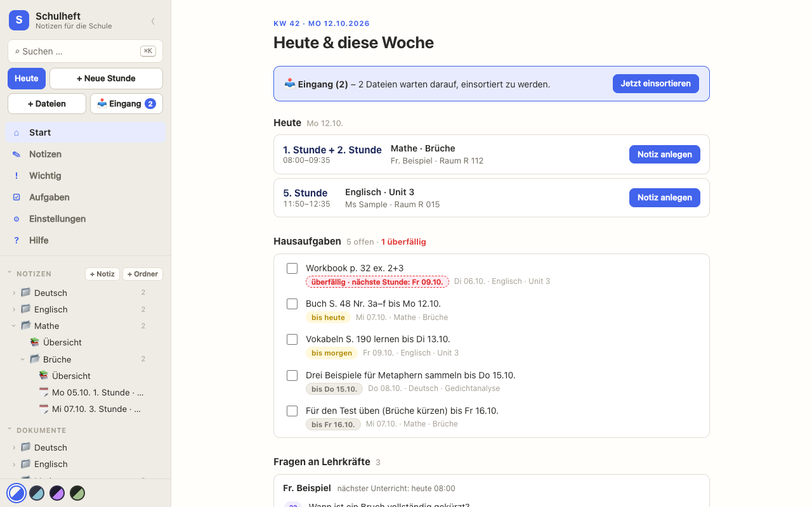
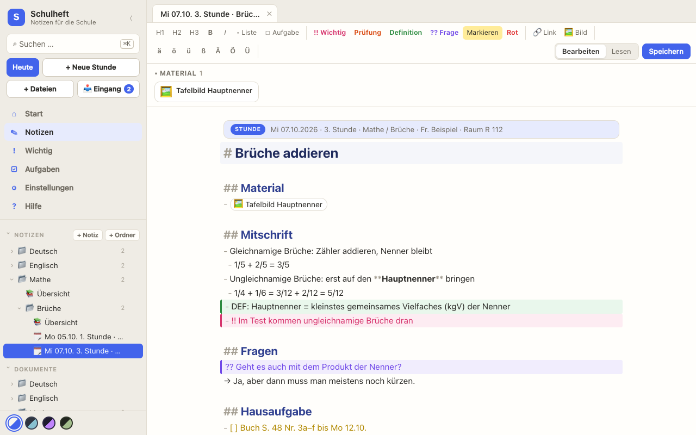
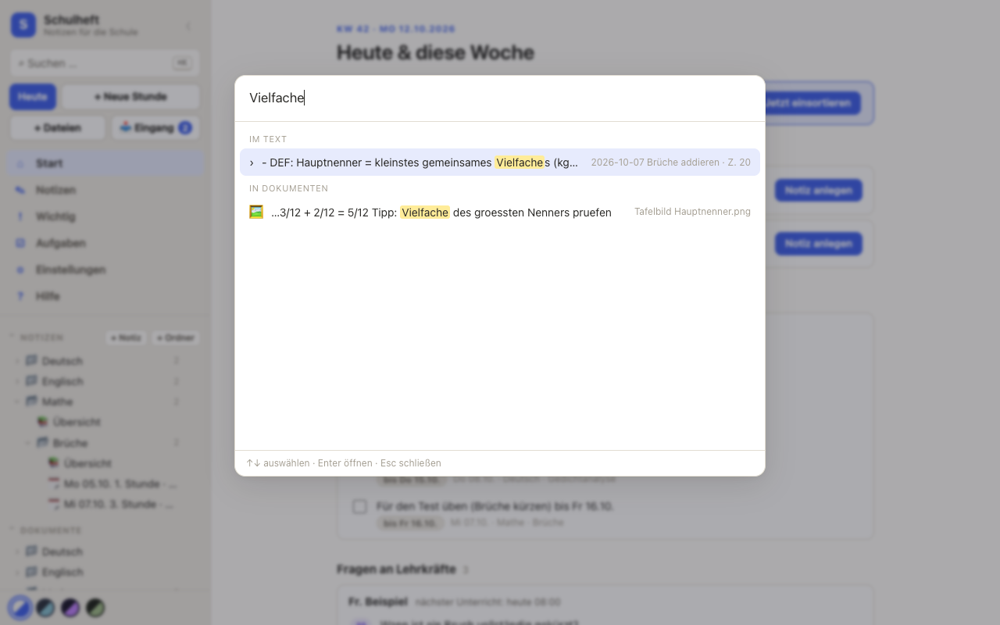
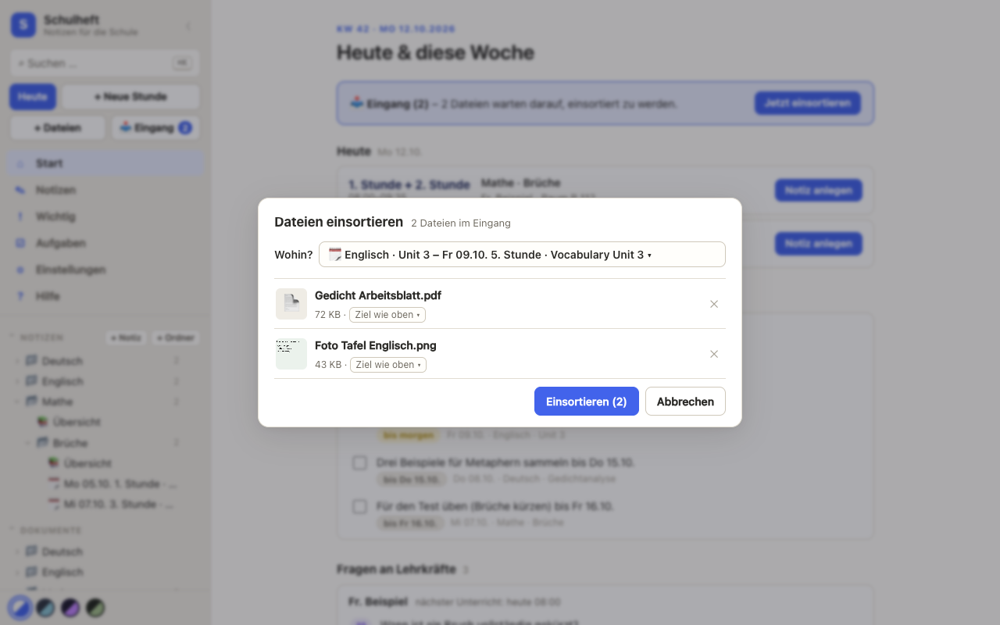
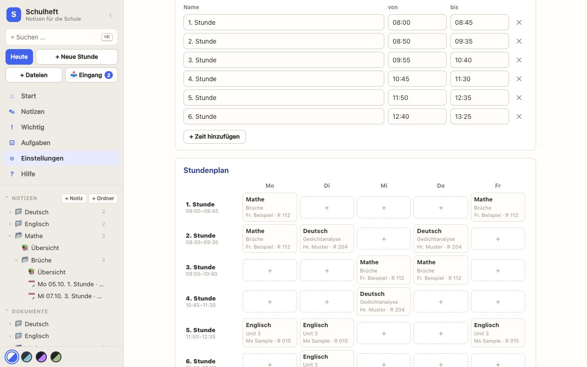

# Schulheft

**Dein digitales Schulheft für Schule und Ausbildung: Stunden mitschreiben, Hausaufgaben im Blick behalten, Arbeitsblätter an einem Ort.**

🌐 Website: <https://pedrog-git.github.io/schulheft/>
⬇️ **[Schulheft für Windows herunterladen](https://github.com/pedroG-git/schulheft/releases/latest/download/Schulheft-Setup.exe)**



## Was Schulheft kann

- **Ordnung wie im Heft:** Fach → Einheit → Stunde. Jede Stunde hat Material, Mitschrift, Fragen und Hausaufgabe.
- **Startseite „Heute & diese Woche“:** deine Stunden von heute, offene Hausaufgaben mit Frist und Fragen an Lehrkräfte.
- **Stundenplan und Unterrichtszeiten** in den Einstellungen – neue Stunden sind mit einem Klick angelegt.
- **Hausaufgaben mit Frist:** „bis Fr 16.10.“ in die Aufgabe schreiben, oder Schulheft nimmt die nächste Stunde laut Stundenplan.
- **Markierungen:** `!!` Wichtig, `DEF:` Definition, `TEST:` Prüfung, `??` Frage – alles gesammelt auf der Seite „Wichtig“.
- **Dateien einsortieren:** PDFs, Fotos und Office-Dateien reinziehen; Schulheft schlägt die passende Stunde vor. Dateien im Ordner `_Eingang` warten, bis du sie einsortierst.
- **PDF-Betrachter** mit Anmerkungen (Stift, Marker, Text, Notizzettel, Pfeile …).
- **Suche mit Strg+K** – durch Notizen, PDFs und sogar Text auf Fotos (Texterkennung/OCR, Deutsch und Englisch).
- Funktioniert komplett **offline**, mehrere Farbschemata.

| Stunde im Editor | Suche mit Texterkennung |
|---|---|
|  |  |
| **Dateien einsortieren** | **Stundenplan** |
|  |  |

## Was Schulheft nicht kann

Ehrlich gesagt:

- **Keine Cloud, kein Konto.** Deine Dateien bleiben auf deinem Computer. Wenn du sie auf mehreren Geräten willst, wähle einfach einen OneDrive- oder Dropbox-Ordner als Notizordner.
- **Keine Handy-App.**
- **Kein gemeinsames Arbeiten** und kein Teilen mit anderen.
- **Kein Lernprogramm** – keine Karteikarten, keine Quizze.
- **Handschrift** erkennt die Texterkennung deutlich schlechter als gedruckten Text.
- Hinzufügen kannst du nur **PDFs, Bilder und Office-Dateien** (Word, Excel, PowerPoint, OpenDocument).
- Die Oberfläche gibt es **nur auf Deutsch**.
- Der Installer ist **nicht signiert** – deshalb warnt Windows beim ersten Start (siehe unten).

## Installation

### Windows

1. [`Schulheft-Setup.exe` herunterladen](https://github.com/pedroG-git/schulheft/releases/latest/download/Schulheft-Setup.exe) und starten.
2. Windows SmartScreen meldet sich, weil der Installer nicht signiert ist: **„Weitere Informationen“ → „Trotzdem ausführen“**.
3. Beim ersten Start wählst du deinen Notizordner – fertig.

Updates kommen automatisch. Deine Notizen werden bei Updates nie angefasst.

### Aus dem Quellcode starten

Du brauchst [Node.js](https://nodejs.org) **22.13 oder neuer**.

```sh
npm install
npm run build
npm start
```

Dann im Browser <http://localhost:4711> öffnen. Unter Windows erledigt `start.cmd` alles auf einmal (installieren, bauen, starten, Browser öffnen).

## Deine Daten

- Deine Notizen sind **ganz normale `.md`-Dateien** (Markdown) in dem Ordner, den du ausgewählt hast – lesbar mit jedem Texteditor, auch ohne Schulheft.
- Dateien liegen daneben im Ordner `Material`, PDF-Anmerkungen in einer kleinen `.anmerkungen.json` neben der PDF.
- Stundenplan und Unterrichtszeiten liegen im Notizordner unter `.schulheft/einstellungen.json` – sie wandern also mit deinen Notizen mit.
- Welcher Ordner dein Notizordner ist, merkt sich Schulheft in `config.json`:
  - Windows: `%APPDATA%\Schulheft`
  - macOS: `~/Library/Application Support/Schulheft`
  - Linux: `~/.config/schulheft`
- Die Texterkennung legt einen Zwischenspeicher an (Windows: `%LOCALAPPDATA%\Schulheft\Cache`). Den kannst du jederzeit löschen.

## Lizenz

[MIT](LICENSE). Verwendete Bibliotheken und Schriften: siehe [THIRD_PARTY_NOTICES.md](THIRD_PARTY_NOTICES.md).
